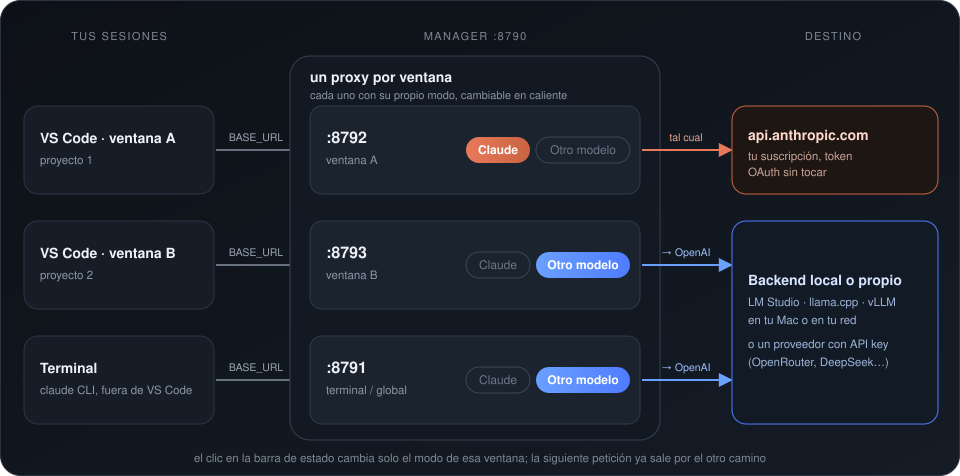

# claude-switch

Cambia entre **Claude (suscripción)** y **cualquier otro modelo** —uno local, uno en otra máquina de tu red o un proveedor con API key— en Claude Code con un clic, sin cerrar sesiones ni ventanas de VS Code.

<p align="center"></p>

📖 **[Tutorial de instalación paso a paso](docs/INSTALACION.md)** · 🧠 [Arquitectura](docs/ARQUITECTURA.md)

El truco: Claude Code apunta **siempre** a un proxy local. El proxy decide por dónde manda cada petición, y ese cambio es en caliente — la próxima petición de la sesión abierta usa el otro modelo. No hay que reiniciar nada.

### Modo por-ventana

Cada **ventana** de VSCode tiene su **propio proxy y su propio modo**: la extensión escribe `ANTHROPIC_BASE_URL` apuntando a su puerto en `.claude/settings.local.json` del proyecto (Claude Code lo lee por proyecto y pisa el valor global). Así puedes tener una ventana en Claude y otra con otro modelo al mismo tiempo, y el clic en la barra de estado solo afecta a la ventana donde lo haces.

- El CLI fuera de VSCode (terminal) usa el proxy **default** (`Terminal / global` en la UI).
- La página web del manager (puerto 8790) lista todas las ventanas activas con su modo y botones para cambiarlo.
- Los puertos se asignan de forma estable por ventana (sobreviven recargas); al cerrar la ventana se liberan.
- Dos ventanas del *mismo* proyecto comparten puerto (mismo modo). Ventanas de proyectos distintos son independientes.

## Características

- 🟠 **Modo Claude**: passthrough transparente a `api.anthropic.com`. Tu token OAuth de la suscripción (Pro/Max) pasa intacto; el proxy no lo guarda ni lo ve.
- 🔵 **Modo alternativo** (`qwen` en los comandos, por razones históricas; sirve para cualquier modelo): convierte la Anthropic Messages API a formato OpenAI y manda a tu backend (LM Studio, llama.cpp en la red, vLLM… o un proveedor con API key). Soporta streaming SSE, tool calls (`tool_use`/`tool_result`), system prompts, imágenes base64 y `tool_choice`.
- 🖱️ **Un clic**: extensión de VSCode con indicador en la barra de estado (`🟠 Claude · suscripción` / `🔵 <nombre de tu modelo>`), atajo `⌘⌥M`, página web con dos botones grandes, o alias de terminal.
- 🔄 **Cambio en caliente**: sin cerrar sesiones, terminales ni ventanas. El modo persiste entre reinicios.
- 🩺 **Salud**: la UI y la barra de estado indican si tu backend responde antes de que lo necesites.
- 📦 **Cero dependencias**: Node ≥ 18, un solo archivo de servidor.

## Escenarios de uso

El proxy solo necesita dos cosas: tu sesión de Claude Code y un backend OpenAI-compatible. Según lo que tengas:

| Escenario | Modo `claude` | Modo `qwen` (backend) | Config clave |
|---|---|---|---|
| **A. Suscripción + modelo local en tu Mac** | Suscripción Pro/Max (OAuth, passthrough) | LM Studio en `127.0.0.1:1234` | defaults |
| **B. Suscripción + servidor propio (LAN/Tailscale)** | Suscripción | `llama-server` (llama.cpp) en otra máquina, p. ej. varias sesiones a la vez | `lmstudioBase: "http://<ip>:8090/v1"`, `maxPromptTokens` según el contexto por sesión |
| **C. Suscripción + otro proveedor con API key** | Suscripción | OpenRouter, DeepSeek, OpenAI… | `lmstudioBase`, `qwenModel`/`haikuModel` = ids del proveedor, `backendApiKey` |
| **D. API key de Anthropic en vez de suscripción** | `ANTHROPIC_API_KEY` en Claude Code: el proxy la reenvía tal cual | cualquiera de A–C | Claude Code manda su credencial; el proxy no la toca |

Ejemplo C (OpenRouter):

```json
{
  "lmstudioBase": "https://openrouter.ai/api/v1",
  "qwenModel": "qwen/qwen3-coder",
  "haikuModel": "qwen/qwen3-coder",
  "extraOpenAI": {},
  "backendApiKey": ""
}
```

```bash
export CLAUDE_SWITCH_BACKEND_KEY=sk-or-...   # antes de ./switch.sh start (o en el LaunchAgent)
```

> `extraOpenAI` es específico del backend: `thinking_budget_tokens` y `chat_template_kwargs` son de llama.cpp; con proveedores en la nube déjalo vacío salvo que su documentación diga otra cosa.

### Qué pasa con el contexto al cambiar de modelo

- **La conversación no se pierde**: Claude Code guarda el historial y lo reenvía completo en cada petición; el proxy lo traduce y el otro modelo lo recibe entero.
- **Se pierde la caché**: el modelo al que cambias no tiene el historial cacheado y reprocesa todo el prompt. Con modelos locales y sesiones largas la primera respuesta puede tardar minutos. Haz `/compact` antes de cambiar si la sesión es larga.
- **Ventanas distintas**: Claude Code compacta pensando en ~200k tokens, pero tu modelo local puede tener menos. Si el historial no cabe, el proxy descarta los mensajes más viejos (ver `maxPromptTokens`) en vez de dejar que el backend rechace la petición.
- **Los bloques de "thinking"** de Claude no se envían al backend OpenAI; el estilo y las respuestas cambian a mitad de conversación porque es otro modelo.
- Si se agota tu cuota de suscripción, cambia a `qwen` (botón de la barra de estado o `./switch.sh qwen`): la siguiente petición ya sale por el backend.

### Servir un modelo con llama.cpp para varias sesiones

`--ctx-size` es el contexto **total**, y se reparte entre los slots: con `--parallel N` cada sesión tiene `ctx-size / N`. Ejemplo medido (Qwen 27B cuantizado, 24 GB de VRAM repartidos en 2 GPUs): `--ctx-size 212992 --parallel 2` → 2 sesiones de 106.496 tokens; una tercera petición espera en cola. Con KV cuantizado (`--cache-type-k q4_0 --cache-type-v q4_0 --flash-attn on`) cabe el doble de contexto. Pon en `maxPromptTokens` un valor por debajo de tu contexto por sesión.

Razonamiento (modelos thinking): según un test agéntico propio de 5 tareas pequeñas × 4 niveles, un tope medio (`--reasoning-budget 2000` o `"extraOpenAI": {"thinking_budget_tokens": 2000}`) mantuvo la calidad con tiempos razonables; apagarlo (`chat_template_kwargs.enable_thinking=false`) fue ~40 % más rápido para ediciones mecánicas. Mide con tus propias tareas.

## Requisitos

- [Node.js](https://nodejs.org) ≥ 18 (el servidor)
- Claude Code (CLI y/o extensión de VSCode) con **suscripción** activa
- Para el modo alternativo: **cualquier backend OpenAI-compatible** corriendo con el modelo cargado — [LM Studio](https://lmstudio.ai) local, `llama-server` (llama.cpp) en otra máquina de tu LAN/Tailscale, vLLM, etc. El default apunta a LM Studio en `http://127.0.0.1:1234`

## Instalación

### 1. Clonar

```bash
git clone https://github.com/Drozast/claude-switch.git
cd claude-switch
```

### 2. Configurar (si tu setup difiere del default)

Copia la plantilla (`config.json` es local y está en `.gitignore`) y edítala:

```bash
cp config.example.json config.json
```

```json
{
  "port": 8790,
  "anthropicTarget": "https://api.anthropic.com",
  "lmstudioBase": "http://127.0.0.1:1234/v1",
  "qwenModel": "qwen3-coder-30b",
  "haikuModel": "qwen3-coder-30b"
}
```

| Clave | Descripción |
|---|---|
| `port` | Puerto del proxy (default 8790) |
| `anthropicTarget` | Endpoint de Anthropic al que reenvía el modo claude |
| `lmstudioBase` | Base OpenAI-compatible del backend local (incluye `/v1`). Sirve para **cualquier** backend: LM Studio, llama.cpp/llama-server en tu LAN o Tailscale, vLLM, etc. |
| `qwenModel` | Modelo para peticiones sonnet/opus (el id que aparece en `GET /v1/models`) |
| `haikuModel` | Modelo para peticiones haiku (tareas en background) |
| `backendApiKey` | Clave del backend si es un proveedor con API key (OpenRouter, DeepSeek, OpenAI…). Se envía como `Authorization: Bearer`. También vale la variable de entorno `CLAUDE_SWITCH_BACKEND_KEY` (mejor: no queda en disco). Vacía para backends locales |
| `maxPromptTokens` | Tope estimado (chars/3) del prompt en modo qwen. Si el historial lo supera se descartan los mensajes más antiguos y se avisa en el log. Pon (contexto por sesión de tu backend − tokens de salida); default 85000 |
| `debugRequests` | `true` guarda la última petición en `debug-last-request.json` para depurar. **Contiene tu conversación**: está en `.gitignore`, no la compartas |
| `extraOpenAI` | Objeto que se mezcla en cada request OpenAI. Ej.: `{"chat_template_kwargs":{"enable_thinking":false}}` para modelos thinking de llama.cpp, o un `temperature` fijo |
| `maxPromptTokens` | Tope estimado (chars/3) del prompt en modo qwen; si el historial lo supera se descartan los mensajes más viejos y se avisa en el log. Default 85000 (sesión de 106k menos la salida) |

### 3. Apuntar Claude Code al proxy

Agrega esto a `~/.claude/settings.json` (aplica a CLI y extensión de VSCode):

```json
{
  "env": {
    "ANTHROPIC_BASE_URL": "http://127.0.0.1:8790"
  }
}
```

> ⚠️ No agregues `ANTHROPIC_AUTH_TOKEN` ni `ANTHROPIC_API_KEY`: con suscripción, Claude Code envía su token OAuth y el proxy lo reenvía tal cual.

### 4. Arranque automático (macOS)

```bash
./install-autostart.sh
```

Crea un LaunchAgent (`com.drozast.claude-switch`) que arranca el proxy al iniciar sesión y lo reinicia si muere. En Linux usa `systemd --user`; en Windows, Task Scheduler o `nssm`.

### 5. Extensión de VSCode (opcional, para el clic)

```bash
cd vscode-ext
npx @vscode/vsce package --allow-missing-repository
code --install-extension claude-model-switch-*.vsix
```

Te da:
- Indicador en la barra de estado (abajo a la izquierda): clic para alternar
- Atajo `⌘⌥M` (toggle)
- Icono `$(window)` junto al indicador: abre el panel del manager (todas las ventanas) dentro de VSCode, sin navegador
- Comandos en la paleta: *Claude Switch: Cambiar modelo / Usar Claude / Usar otro modelo / Abrir panel de ventanas*

Tras instalarla, recarga la ventana y abre una sesión nueva de Claude Code (las ya abiertas conservan su puerto anterior).

## Uso

| Método | Acción |
|---|---|
| **Barra de estado VSCode** | Clic en `🟠 Claude · suscripción` ↔ `🔵 <tu modelo>` — **solo afecta a esa ventana** |
| **Atajo** | `⌘⌥M` (en la ventana activa) |
| **Web** | http://127.0.0.1:8790 — todas las ventanas + proxy de terminal, con botones por fila |
| **Terminal** | `./switch.sh status` (lista todo) · `./switch.sh qwen [puerto]` · `./switch.sh claude [puerto]` · `./switch.sh toggle [puerto]` — sin puerto, actúa sobre el proxy de terminal |

Para usar el otro modelo: arranca tu backend con el modelo cargado, haz clic en 🔵 y listo. Para volver: clic en 🟠. Las conversaciones abiertas continúan exactamente donde estaban; solo la **próxima** petición cambia de modelo.

## Operación

```bash
./switch.sh start     # arrancar (usa launchd si está instalado)
./switch.sh stop      # detener
./switch.sh status    # modo actual + salud de LM Studio
./switch.sh toggle    # alternar
./switch.sh claude    # forzar modo claude
./switch.sh qwen      # forzar modo qwen
```

Archivos: `config.json` (configuración) · `states/` (modo por proxy, generado) · `manager-state.json` (asignación de puertos, generado) · `server.log` / `server.err.log` / `proxy-<puerto>.*.log` (logs).

## Documentación

- [docs/ARQUITECTURA.md](docs/ARQUITECTURA.md) — cómo funciona el proxy, la conversión Anthropic↔OpenAI, API de control, seguridad y troubleshooting.

## Notas

- **Límites de sesión**: en modo Claude sigues consumiendo tu suscripción (incluidos los límites de 5h/semana). El modo alternativo corre en tu backend: si es local no tiene límites de uso (depende de tu máquina); si es un proveedor, se rige por su plan.
- **El proxy debe estar corriendo**: si no, Claude Code no conecta. Con el autostart no debería pasar; si pasa, `./switch.sh start`.
- **Backend local**: el modo alternativo mapea *todos* los nombres de modelo de Claude a `qwenModel`/`haikuModel`. El backend puede ser LM Studio, llama.cpp (`llama-server`) en otra máquina de tu red (LAN/Tailscale), vLLM… cualquier API OpenAI-compatible que soporte streaming y function calling.
- **Modelos thinking** (llama.cpp): limita el razonamiento con `"extraOpenAI": {"thinking_budget_tokens": 2000}` o apágalo con `{"chat_template_kwargs": {"enable_thinking": false}}`; sin tope, las respuestas pueden consumir los tokens en reasoning y llegar vacías.
- **Privacidad**: el proxy no guarda tus peticiones (solo con `debugRequests: true`) ni tu token OAuth; `config.json`, `states/` y `manager-state.json` son locales y no se versionan.

## Licencia

[MIT](LICENSE)
